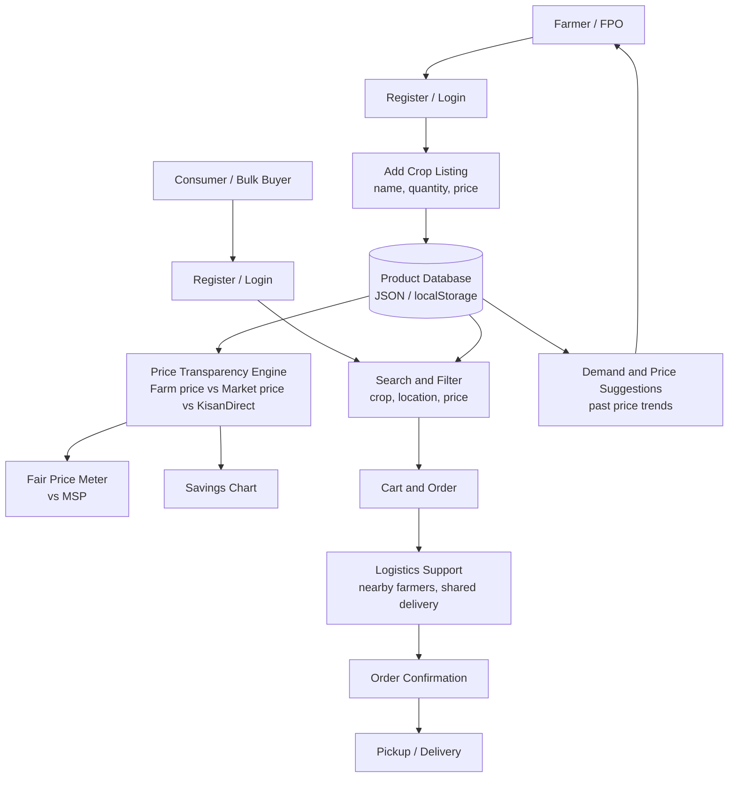

# Smart India Hackathon Workshop
# Date:24-11-2026
## Reference Number:26011138
## Name: Rakesh J 

## Problem Title
SIH 26033: Multiple intermediaries reduce farmers earnings and increase consumer prices.

## Problem Creater's Organization
Ministry of Consumer Affairs, Food & Public Distribution

## Theme
Agriculture, FoodTech & Rural Development

## Problem Description
Expected Solution: Create a digital marketplace that:

• Connects farmers/FPOs directly with consumers and bulk buyers.
• Provides logistics support.
• Uses AI for demand forecasting and route optimization.

Benefits:

• Better prices for farmers.
• Lower prices for consumers.
• Reduced supply chain inefficiencies.

## Proposed Solution
## KisanDirect: A Farm-to-Consumer Price Transparency Portal

**Detailed explanation**

KisanDirect is a web-based marketplace where farmers and Farmer Producer Organizations (FPOs) list their produce directly, and consumers, local shops and bulk buyers purchase it without going through agents, wholesalers or retailers. Every listing shows a price breakdown so that buyers and farmers can see where each rupee goes.

**Key features**

1. **Farmer/FPO portal:** register, list crops with quantity, price and harvest date, and update stock.
2. **Buyer marketplace:** search and filter by crop, location and price; add to cart; place orders for retail or bulk quantities.
3. **Price transparency calculator:** compares the farmer price, the traditional market price (with middlemen margins) and the KisanDirect price, and shows the savings in a chart.
4. **Logistics support:** a "nearby farmers" filter and pickup/delivery options to cut transport cost, with shared delivery for orders in the same area.
5. **Smart suggestions (AI-based):** price and demand suggestions for farmers based on past price trends, and a suggested delivery order for nearby orders.
6. **Bilingual interface (Tamil/English)** with simple icons for easy use by farmers.
7. **Mobile-responsive design** since most farmers use phones.

**How it addresses the problem**

| Problem | KisanDirect's answer |
|---|---|
| Multiple middlemen take a margin at each step | Direct listing and ordering removes the agent, wholesaler and retailer layers |
| Farmers do not know fair market prices | Price transparency calculator and price suggestions |
| Consumers pay inflated prices | Buying at near farm-gate price plus a small delivery fee |
| Transport is costly and unorganised | Nearby-farmer matching and shared delivery |

**Innovation and uniqueness**

- **Fair Price Meter:** every listing is rated green, yellow or red against the government Minimum Support Price (MSP) and the average market price, so buyers and farmers know instantly whether a price is fair.
- **Group buying:** apartment communities and shops can combine orders to get bulk prices and share delivery.
- **Voice-based listing:** farmers can add a listing by speaking, using the browser Web Speech API, which helps low-literacy users.

## Technical Approach
**Technologies to be used**

| Layer | Technology | Purpose |
|---|---|---|
| Structure | HTML5 | Pages, registration and listing forms |
| Styling | CSS3 | Custom layout and theme |
| Interactivity | JavaScript (ES6) | Cart, search/filter, price calculator, validation, voice input |
| UI framework | Bootstrap 5 | Responsive grid, navbar, cards, modals |
| Charts | Chart.js | Price comparison and savings chart |
| Data (prototype) | JSON / localStorage | Stores listings, users and orders |
| Future backend | Node.js + MongoDB | Real database and user authentication |
| Future AI | Simple trend-based forecasting, later ML | Demand and price forecasting, route optimization |

**Methodology and process for implementation**

1. **Requirement analysis:** identify the users (farmers/FPOs, consumers, bulk buyers) and their needs.
2. **UX design:** wireframes for the farmer dashboard, marketplace and cart, with a simple icon-led layout.
3. **Frontend development:** build pages with HTML, CSS and Bootstrap.
4. **Logic development:** implement the cart, search/filter, price calculator and form validation in JavaScript.
5. **Smart features:** add price suggestions from past price data, and nearby-farmer matching.
6. **Testing:** test on mobile and desktop browsers, and validate forms.
7. **Deployment:** host on GitHub Pages for the prototype.

**Flowchart**

## Feasibility and Viability
**Analysis of the feasibility of the idea**

- **Technical:** the prototype uses only standard web technologies (HTML, CSS, JavaScript, Bootstrap), so it can be built and hosted at almost no cost.
- **Economic:** the platform can sustain itself with a small service or delivery fee, far below the margin taken by multiple middlemen.
- **Operational:** FPOs already aggregate farmers, so they can act as the supply partner and local pickup point.
- **Social:** a bilingual, icon-based, mobile-first interface suits farmers who use smartphones.

**Potential challenges and risks**

- Low digital literacy among some farmers.
- Unreliable internet in rural areas.
- Logistics and cold-chain costs for perishable produce.
- Building trust between new buyers and farmers.
- Price manipulation or fake listings.

**Strategies for overcoming these challenges**

| Challenge | Strategy |
|---|---|
| Low digital literacy | Voice-based listing, regional language, icon-led design, training through FPOs |
| Poor connectivity | Lightweight pages and offline-friendly design |
| Logistics cost | Nearby-farmer matching, shared delivery, group buying |
| Trust | Farmer profiles, ratings and reviews, FPO verification |
| Price manipulation | Fair Price Meter against MSP and market average |

## Impact and Benefits
**Potential impact on the target audience**

- **Farmers/FPOs:** a higher share of the final price, direct access to buyers, and better price awareness.
- **Consumers:** lower prices and fresher produce.
- **Bulk buyers and shops:** reliable supply directly from the source.

**Benefits of the solution**

- **Social:** empowers small farmers and builds trust through price transparency.
- **Economic:** increases farmer income, lowers consumer prices, and keeps more money in rural areas.
- **Environmental:** shorter supply chains and shared delivery reduce transport emissions, and better demand forecasting reduces post-harvest waste.
## Research and References
1. Smart India Hackathon, SIH 26033 problem statement: https://www.sih.gov.in
2. Ministry of Consumer Affairs, Food & Public Distribution: https://consumeraffairs.nic.in
3. e-NAM (National Agriculture Market): https://enam.gov.in
4. Agmarknet, agricultural market price data: https://agmarknet.gov.in
5. Government of India, Minimum Support Price (MSP) information: https://agricoop.nic.in
6. Bootstrap documentation: https://getbootstrap.com
7. Chart.js documentation: https://www.chartjs.org
8. MDN Web Docs, Web Speech API: https://developer.mozilla.org/en-US/docs/Web/API/Web_Speech_API
